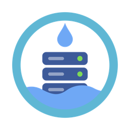
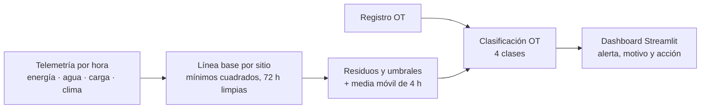

<p align="center">
  
</p>

<h1 align="center">DripSafe</h1>

<p align="center">
  <b>Que cada litro y cada kWh que sobra se note a tiempo.</b><br>
  Detección de anomalías en el enfriamiento de centros de datos: eficiencia y ciberseguridad OT con un solo modelo.
</p>

<p align="center">
  Hackatón CIFOX · AguaSegura AI · Sub-reto 3 · UPY, Mérida · 22 de octubre de 2026
</p>

> [!IMPORTANT]
> **DATOS SIMULADOS.** Todas las cifras salen del kit CIFOX, que simula tres sitios ficticios durante 7 días. Cada cifra lleva su tipo: *observado*, *medido*, *estimado* o *proyectado*. Una proyección no es un ahorro observado.

---

## Qué hace

DripSafe aprende cuánto **debería** gastar cada sitio según su carga y la temperatura exterior, compara cada hora lo real contra lo esperado y cruza los excesos con el registro OT. Así separa cuatro casos:

| Clase | Qué significa |
|---|---|
| **Incidente con efecto físico** | Evento OT seguido de un exceso de energía o agua |
| **Cambio no autorizado** | Cambio de configuración que todavía no mueve la física |
| **Escalón sin registro** | Exceso sin evento OT: falla o cambio que no dejó huella |
| **Intento de acceso** | Logins fallidos sin efecto |

Ningún exceso sin explicar va directo a mantenimiento, y DripSafe nunca manda órdenes: **solo avisa; decide una persona**.



Es la línea base de medición y verificación de ASHRAE Guideline 14, aplicada a detectar en tiempo real. Corre en CPU, sin nube, sin GPU y sin LLM.

## Resultados

Fuente única: [`resultados/numeros_oficiales.json`](resultados/numeros_oficiales.json), con el balance neto validado en conjunto.

| | Resultado | Tipo |
|---|---|---|
| **Episodios del kit** | 3 de 3 detectados, 0 falsas alarmas; empate con las reglas fijas del kit | Observado |
| **Fallas pequeñas** | DripSafe detecta desde **+10 %** (18 de 18); las reglas fijas, desde +80 % y solo 6 de 18 | Observado sobre inyecciones |
| **Punto ciego del umbral fijo** | Un sitio eficiente puede subir su energía no TI **158 %** sin cruzar PUE 1.6 | Estimado |
| **PUE** | 1.278 → **1.268** si se atiende cada alerta física | Proyectado |
| **WUE** | 0.394 → **0.366** L/kWh TI | Proyectado |
| **Costo del detector** | **33.6 ms** por corrida · 1.3 × 10⁻⁵ kWh/año · 0.006 g CO₂e/año | Medido · estimado (TDP) |
| **Ahorro del escenario** | **10,768 kWh/año** · **4,781 kg CO₂e/año** · 11,461 L/año in situ + 22,216 L/año en la generación eléctrica | Proyectado |
| **Bono Zero Freshwater** | Circuito cerrado W40 + enfriador seco + chiller por aire: PUE **1.284** con cero agua potable de enfriamiento | Proyectado |

Los kWh del detector salen de CodeCarbon con la potencia de diseño del procesador como hipótesis, no de un medidor de pared. El CO₂ usa el factor del SEN de SEMARNAT (0.444 kgCO₂e/kWh).

## Cómo correrlo

Requisitos: **Python 3.12**. No necesita GPU, cuentas ni internet después de instalar.

> [!TIP]
> **En macOS, doble clic en [`DripSafe.command`](DripSafe.command)**: crea el entorno si falta, comprueba el kit, cierra cualquier dashboard viejo y abre la demo en el navegador. No toca las cifras oficiales.

```bash
python3.12 -m venv .venv
.venv/bin/python -m pip install -r requirements.txt
```

**Sin el kit** (datos sintéticos, para probar):

```bash
.venv/bin/python -m src.sinteticos --dias 14 --salida data/sinteticos/telemetria.csv
.venv/bin/python -m pytest -q
```

**Con el kit** (confidencial, fuera del repo):

```bash
# Regenera alertas, evaluación y cifras oficiales
.venv/bin/python -m src.pipeline --kit "/ruta/al/kit/data/operaciones_simuladas.csv"

# Abre el dashboard en http://localhost:8501
export DRIPSAFE_KIT="/ruta/al/kit"
.venv/bin/python -m streamlit run app/main.py
```

Detalles del dashboard en [`app/README.md`](app/README.md) y de la regeneración de cifras en [`resultados/README.md`](resultados/README.md).

## Estructura

```text
dripsafe/
├── app/           Dashboard en Streamlit (demo del pitch)
├── src/
│   ├── datos/       Carga y limpieza del kit al contrato de datos
│   ├── modelo/      Detector: línea base, umbrales, explicación y medición
│   ├── ot/          Tabla de decisión de las 4 clases OT
│   ├── ataques/     Escenarios e inyecciones de la rejilla fija
│   ├── evaluacion/  Métricas por episodio y comparación contra las reglas del kit
│   └── metricas/    PUE, WUE, balance neto, refrigeración y bono
├── resultados/    Cifras oficiales (solo agregados, sin filas del kit)
├── config/        Traducción de columnas del kit al contrato
├── tests/         Pruebas automáticas con datos sintéticos
├── docs/          Documentación del proyecto
└── data/          Kit y derivados: NO se sube (.gitignore)
```

## Documentación

| | Documento | De qué trata |
|---|---|---|
| 01 | [Convocatoria](docs/01-convocatoria.md) | Reglas, entregables, criterios y bono |
| 02 | [Decisiones](docs/02-decisiones.md) | Qué decidimos y por qué |
| 05 | [Solución técnica](docs/05-solucion-tecnica.md) | Arquitectura, modelo, métricas y balance neto |
| 06 | [Ciberseguridad OT](docs/06-ciberseguridad-ot.md) | Modelo de amenazas Purdue y MITRE ATT&CK for ICS |
| 07 | [Agua y acuífero](docs/07-agua-y-acuifero.md) | Acuífero 3105 de Yucatán, balance neto y bono |
| 08 | [Pitch](docs/08-pitch.md) | Guion, criterios y preguntas del jurado |
| 11 | [Trabajo en paralelo](docs/11-trabajo-en-paralelo.md) | Contratos entre piezas |
| 12 | [Trazabilidad](docs/12-trazabilidad.md) | Requisito → issue → evidencia |
| 13 | [Yucatán: mercado y acuífero](docs/13-yucatan-mercado-y-acuifero.md) | A quién le vendemos, los cenotes y cómo crecemos |

También: [equipo y roles](docs/03-equipo-y-roles.md), [plan de trabajo](docs/04-plan-de-trabajo.md), [recursos](docs/09-recursos.md), [preguntas frecuentes](docs/10-faq.md), [CONTRIBUTING](CONTRIBUTING.md) y [AGENTS](AGENTS.md) (contexto para asistentes de IA).

## Límites

- Datos simulados de 3 sitios y 7 días: no valida eficacia en plantas reales.
- Una sola semana de clima: hace falta una línea base por época (secas, lluvias y nortes).
- Sin sensores de agua helada ni por equipo; un exceso sin registro OT no distingue falla de ataque.

La siguiente validación es con datos reales de una sala de cómputo en Yucatán.

## Reglas

- **El kit es confidencial:** nunca se sube ni se comparte. `data/` está en `.gitignore` y las pruebas usan solo datos sintéticos.
- **Prohibido atacar sistemas reales:** todo se prueba sobre el kit o con datos simulados.

## Licencias

El código, la documentación y los demás materiales originales de DripSafe tienen **todos los derechos reservados**. Consulta [LICENSE.md](LICENSE.md). Las fuentes incluidas y otros componentes de terceros mantienen sus propias condiciones; consulta [THIRD_PARTY_LICENSES.md](THIRD_PARTY_LICENSES.md). El kit CIFOX no se distribuye en este repositorio.

## Equipo

**Leo** (líder) · **Misael** · **Gadiel** · **Nico** · **Guillermo**, estudiantes de Ingeniería de Software. Roles en [docs/03](docs/03-equipo-y-roles.md).

Contacto CIFOX: gloria.vlencia@cifox.org · mariana.gomez@cifox.org · [convocatoria oficial](https://vaporlatierra.com/2026/convocatoria-hackaton-cifox-aguasegura-ai/)
