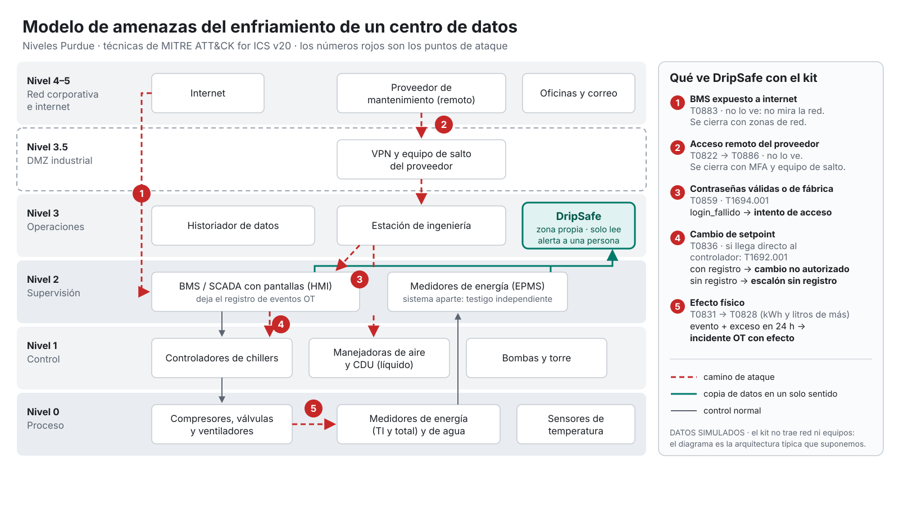

# 06 · Ciberseguridad OT

> **Dueño:** Guille. Cubre el criterio «Impacto en ciberseguridad» (§13 de la convocatoria), la regla 18 (nada de ataques a sistemas reales) y el reto 2 del kit («documentad qué no puede inferirse de un evento sintético»). Las técnicas son de **MITRE ATT&CK for ICS v20** (13 oct 2026), verificadas contra el catálogo oficial de MITRE.

**En un minuto:**
- DripSafe **no** mira la red. Mira la **física**: cuánta energía y agua debería gastar cada sitio según su carga y su clima. Un cambio de configuración puede pasar un filtro de red con comandos válidos, pero el gasto de energía o agua lo delata.
- Cruza esos excesos con el registro OT y los clasifica en **4 clases**, con prioridad y acción, sin afirmar nunca que un exceso prueba un ataque (§4).
- En el kit, con su ruido, **DripSafe ve el 100 % de los excesos inyectados desde +10 %**. Las reglas fijas del kit no ven ninguno por debajo de +80 % ni ningún exceso de agua (§6).
- En los cambios de configuración con efecto 8 h después, las reglas ven el evento, pero **dejan pasar 1 710 kWh** de exceso; DripSafe deja pasar 5 kWh y lo clasifica como incidente (§6).
- Lo decimos también cuando no nos favorece: con el doble de ruido, a +10 % DripSafe solo ve un tercio; con la ventana de 24 h, **1 de cada 5 eventos OT al azar** encontraría un exceso que no causó; y en una ola de calor fuera de lo aprendido el umbral se duplica y un +10 % pasó sin verse en 8 de 11 tardes (§6, §6b, §7).

## 1. OT en un centro de datos, en una página

- **IT** son las computadoras, los servidores y los datos. **OT** son los sistemas que controlan equipos físicos: chillers, bombas, torres de enfriamiento, manejadoras de aire y válvulas.
- El enfriamiento de un centro de datos es OT. Lo controlan **controladores (PLC)** y un **BMS** (sistema de gestión del edificio) con sus pantallas. La energía la mide, muchas veces, **otro sistema (EPMS)**.
- **Por qué es vulnerable:**
  - **Protocolos sin seguridad.** Modbus (de 1979) y muchas instalaciones de BACnet no autentican ni cifran: quien llega a la red puede leer valores o escribir setpoints.
  - **Equipos de 15 a 20 años** que casi nunca se actualizan.
  - **Redes de oficina y de planta mal separadas.**
  - **Accesos remotos** de proveedores mal protegidos.
- **Modelo Purdue:** divide la red en niveles, desde los sensores y actuadores (nivel 0) hasta la red corporativa e internet (niveles 4–5). La regla de oro es que los niveles bajos no queden expuestos a internet.

## 2. Modelo de amenazas (niveles Purdue)



El diagrama ([`img/modelo-amenazas-purdue.svg`](img/modelo-amenazas-purdue.svg)) está en formato de diapositiva, listo para usarse.

**Supuesto declarado:** el kit no trae red, equipos ni protocolos. El diagrama es la arquitectura típica del enfriamiento de un centro de datos, no la de un sitio real. Sirve para ubicar dónde entraría un atacante y qué parte de su rastro le llega a DripSafe.

| # | Punto de ataque | Técnicas (ATT&CK for ICS v20) | ¿Lo ve DripSafe? |
|---|---|---|---|
| 1 | BMS o pantallas expuestos a internet | T0883 Internet Accessible Device | No: DripSafe no mira la red. Se cierra con zonas de red (M0930) |
| 2 | Acceso remoto del proveedor de mantenimiento | T0822 External Remote Services → T0886 Remote Services | No. Se cierra con MFA (M0932) y un equipo de salto con permisos mínimos |
| 3 | Contraseñas válidas robadas o de fábrica | T0859 Valid Accounts · T1694.001 Default Credentials | Solo los intentos fallidos que quedan en el registro: `login_fallido` → **intento de acceso** |
| 4 | Cambio de setpoint o de configuración | T0836 Modify Parameter. Si la orden llega directo al controlador sin pasar por el BMS: T1692.001 Unauthorized Message: Command Message | Con registro → **cambio no autorizado**. Sin registro → el exceso aparece como **escalón sin registro** |
| 5 | Efecto físico | T0831 Manipulation of Control → T0828 Loss of Productivity and Revenue (kWh y litros de más). Si llega a sobrecalentar: T0879 Damage to Property | Sí: es lo que mide la línea base. Evento + exceso en 24 h → **incidente OT con efecto** |

**Un caso real que se parece: FrostyGoop (MITRE C0041, enero de 2024).** Atacaron la calefacción urbana de una ciudad de Ucrania. El malware (S1165) escribió por **Modbus TCP** valores en controladores ENCO usando **comandos legítimos** (T0836), y dejó sin calefacción a la población; MITRE registra que la reparación tomó dos días. Es climatización como la nuestra, y la lección es la misma: los comandos eran válidos, así que un filtro de red no los distinguía, pero la física cambió.

**MITRE describe nuestra idea como estrategia de detección.** Para T0836, la analítica AN1908 propone alertar ante un cambio de parámetro sin control de cambios «**correlacionado con la deriva posterior del historiador**» y, cuando la telemetría lo permite, exigir un efecto en el proceso. Es la fusión evento–efecto de §4. Para los reportes falsos (T1692.002), AN2215 propone contrastar la telemetría contra **una medición independiente** del mismo fenómeno, que es lo que haría DripSafe con los medidores de energía si el sitio midiera caudal y temperaturas del agua (§3C).

## 3. Tabla ATT&CK final, aplicada al kit

**Aviso de versión:** MITRE **revocó T0855 y T0856** en abril de 2026. Ahora son subtécnicas de T1692 Unauthorized Message: T0855 Unauthorized Command Message pasó a **T1692.001 Command Message** y T0856 Spoof Reporting Message pasó a **T1692.002 Reporting Message**. Si el jurado o el mentor consultan la matriz, ya no van a encontrar los IDs viejos.

### A. Lo que se ve en el kit tal cual

| Técnica | Táctica | Rastro en el kit | Clase en DripSafe | Evidencia |
|---|---|---|---|---|
| T0859 Valid Accounts · T1694.001 Default Credentials (intentos) | Persistencia, movimiento lateral | `login_fallido`, 3 h en SIM-C | Intento de acceso (media) | Kit sin inyecciones: 3 h en esa clase |
| T0836 Modify Parameter | Afectar el control del proceso | `cambio_config_no_autorizado`, 2 h en SIM-C, sin efecto físico | Cambio no autorizado (alta) | Kit sin inyecciones: 2 h en esa clase |

### B. Lo que se inyecta (rejilla, §5)

| Técnica | Qué se simula | Clase esperada | Resultado en el kit |
|---|---|---|---|
| T0836 + T0831 | Cambio registrado y, 8 h después, energía no TI +20 % durante 12 h | Incidente OT con efecto | 16 de 16 vistas y bien clasificadas |
| T0836 sin registro (o T1692.001) | Energía no TI +20 % durante 12 h, sin evento | Escalón sin registro | 17 de 17 |
| T0831 → T0828 | Excesos de energía (+10 a +80 %) y de agua (+25 y +50 %) durante 4 h | Escalón sin registro | 108 de 108 |

### C. Lo que DripSafe **no** puede ver con el kit, y qué haría falta

| Técnica | Por qué no se ve | Qué haría falta medir |
|---|---|---|
| T1692.002 Reporting Message (antes T0856) | Un sensor falso con valores creíbles necesita otro sensor con el que contrastarse | Caudal y temperaturas de suministro y retorno del agua: el balance de calor (caudal × ΔT) contra el medidor de energía, como propone AN2215 |
| T0832 Manipulation of View | Igual: sin balance de calor no hay contra qué comparar lo que ve el operador | Lo mismo, más la energía por equipo (chiller, bombas, torre) |
| T0815 Denial of View | En el kit no faltan datos | Una regla directa: sensores vacíos mientras los medidores de energía siguen reportando |
| T0838 Modify Alarm Settings | Cambiar un límite de alarma no mueve la física | Que el BMS registre esos cambios. Si los registra, DripSafe los trata como cambio no autorizado (alta) |
| T0883, T0822, T0886 | DripSafe no mira el tráfico de red | Un monitor OT de red (Nozomi, Claroty, Dragos). DripSafe lo complementa, no lo sustituye |

Los escenarios del apéndice A demuestran T1692.002, T0832 y T0815 con datos sintéticos que sí traen esos sensores. **No son evidencia del kit**: muestran por qué vale la pena instalar esa instrumentación (propuesta §9).

## 4. Las 4 clases de alerta: tabla de decisión (D16 · U1)

DripSafe no adivina si algo es «falla» o «ataque»: con datos de proceso esas dos cosas a veces se ven igual. Lo que sí puede hacer es **cruzar el registro OT con los excesos físicos** y ordenar la respuesta. Las reglas viven en un solo lugar, [`src/ot/clases.py`](../src/ot/clases.py); el detector las llama y el dashboard muestra lo que sale de ahí. Cada fila de las tablas de abajo tiene una prueba en [`tests/test_clases.py`](../tests/test_clases.py).

**Palabras que usamos (todo es por sitio):**
- **Exceso:** una hora en la que el detector marca energía no TI, agua o temperatura de entrada por encima de lo esperado (por umbral o por la media de 4 h).
- **Tramo:** horas seguidas con exceso. Un hueco en los datos corta el tramo.
- **Evento OT:** horas seguidas con `ot_event` distinto de `normal` (`login_fallido` o `cambio_config_no_autorizado`).
- **Ventana de efecto:** desde la primera hora del evento hasta 24 h después de su última hora. Si el evento ocupa la hora de las 04:00, cuentan los excesos que **empiecen** entre las 04:00 y las 04:00 del día siguiente.
- **Causal:** el tramo **empieza** dentro de la ventana. **Coincidente, no causal:** el tramo ya venía de antes y el evento cae a la mitad.

| Clase | Cuándo | Prioridad | Acción sugerida |
|---|---|---|---|
| **Incidente OT con efecto** | Un tramo empieza dentro de la ventana de un evento OT. También sube a esta clase la hora del cambio que lo causó | Máxima | Restaurar la configuración aprobada y pasar a modo seguro manual; confirmar en sitio |
| **Cambio no autorizado** | Hora con `cambio_config_no_autorizado` sin efecto atribuido (todavía) | Alta | Comparar contra la configuración aprobada y vigilar 24 h |
| **Escalón sin registro** | Exceso sin ningún evento OT que lo cause | Alta | Comparar los setpoints contra la versión aprobada **antes** de mandar a mantenimiento. Si el exceso es de agua, inspección física en paralelo (posible fuga) |
| **Intento de acceso** | Hora con `login_fallido` y sin exceso | Media | Revisar accesos y cuentas. Un login fallido no prueba una intrusión |

**Precedencia:** incidente > cambio no autorizado > escalón sin registro > intento de acceso > normal. Ninguna regla baja la clase que ya tiene una hora.

**Dos reglas de oro:**
1. **Ningún exceso sin explicar va directo a mantenimiento.** Un cambio de setpoint sin registro (T0836 sin log) se ve igual que una falla brusca, así que primero se revisa la configuración.
2. **Ningún cambio no autorizado es «sin urgencia»**, aunque todavía no tenga efecto: puede notarse en el siguiente pico de calor.

### Casos ambiguos y su respuesta

| # | Situación | Respuesta | Por qué |
|---|---|---|---|
| 1 | Cambio a las 04:00 y exceso desde las 12:00 | Incidente (el exceso y la hora del cambio) | La ventana de 24 h cubre el siguiente pico de calor |
| 2 | El exceso empieza 25 h después del cambio | Escalón; el cambio sigue como cambio no autorizado | Fuera de la ventana: se revisa, pero no se atribuye |
| 3 | El exceso ya venía 4 h antes del cambio | Escalón, marcado **coincidente, no causal**; el cambio no baja de prioridad | Un cambio no puede causar algo que ya pasaba |
| 4 | Ese exceso coincidente termina y empieza otro dentro de la ventana | El nuevo es incidente | Es un efecto nuevo después del evento |
| 5 | Un segundo cambio cae a la mitad de un incidente | Sigue siendo incidente | Precedencia. La versión anterior del detector bajaba esa hora |
| 6 | Login fallido y, 6 h después, un exceso | Incidente; el login sigue como intento | Un acceso que sí funcionó no deja evento en el kit: el login pudo ser el paso previo |
| 7 | Tres logins y luego dos horas de cambio (patrón de SIM-C) sin efecto | Intento en los logins y cambio no autorizado en el cambio | Cada hora conserva lo que registró |
| 8 | Login y luego cambio, ambos antes del mismo exceso | Se atribuye al cambio | Es la causa más directa |
| 9 | Login en una hora que ya tenía exceso | Escalón, con una nota del login en el motivo | El exceso es más grave que el intento |
| 10 | Exceso pequeño y sostenido, visto solo por la media de 4 h | Escalón, con forma «gradual» | Mientras «deriva gradual» sea un extra, se trata como posible cambio sin registro |
| 11 | Exceso de agua sin evento | Escalón + inspección física | Posible fuga |
| 12 | Falta una hora de datos a la mitad de un exceso | El tramo se corta en dos | No se inventan horas |

**Límites que declaramos:**
- Un exceso que ya venía de antes y **empeora** después del evento, sin cortarse, se queda como coincidente. Distinguir ese «escalón dentro del escalón» necesita el umbral de cada variable; por ahora lo resuelve una persona.
- Con una ventana de 24 h, un exceso que no tiene nada que ver puede caer dentro **por casualidad**. Por eso lo medimos (siguiente sección) en lugar de suponerlo.

### 4b. ¿Cuántas atribuciones serían pura coincidencia?

La propuesta (§3.3) pide reportar cuántas coincidencias al azar habría. `clases.coincidencias_al_azar()` lo calcula así: sobre la evaluación **sin inyecciones**, pone un evento OT ficticio de 1 h en cada hora posible y revisa si algún tramo de exceso empieza dentro de su ventana. El porcentaje de aciertos es la probabilidad de llamar «incidente OT con efecto» a algo que el evento no causó.

Se reporta para ventanas de 1, 4, 8, 12 y 24 h, porque es un intercambio: una ventana corta casi no se equivoca por casualidad, pero se pierde el caso del cambio que se nota 8 h después. Los resultados sobre el kit están en la §6.

### Mensaje honesto para el pitch

> *"DripSafe no afirma que un residuo pruebe un ciberataque. Distingue un intento (login fallido), un cambio (sin efecto confirmado), un escalón sin registro (falla o cambio no registrado: primero se revisa la configuración) y un incidente con efecto (evento OT seguido de un exceso físico medible). Y dice qué tan seguido esa atribución podría ser casualidad."*

## 5. Rejilla de inyecciones sobre el kit (U1 · U2)

Las 21 anomalías del kit están hechas para que las reglas fijas las vean, así que ahí lo esperado es un empate. Para medir **desde qué tamaño** ve cada método un problema, metemos excesos controlados en copias de la evaluación. La rejilla quedó fijada aquí y en [`src/ataques/rejilla.py`](../src/ataques/rejilla.py) **antes de correrla sobre el kit**, y una prueba (`test_la_rejilla_es_la_que_fijo_la_propuesta`) impide cambiarla sin que se note.

| Inyección | Qué se cambia | Duración | Evento OT | Clase esperada |
|---|---|---|---|---|
| `energia_+10` … `energia_+80` | Energía no TI +10, +20, +40 y +80 % | 4 h | No | Escalón sin registro |
| `agua_+25`, `agua_+50` | Agua +25 y +50 % | 4 h | No | Escalón sin registro |
| `cambio_sin_registro` | Energía no TI +20 % (setpoint cambiado sin dejar registro, T0836) | 12 h | No | Escalón sin registro, **nunca** mantenimiento directo |
| `cambio_con_efecto` | `cambio_config_no_autorizado` y, **8 h después**, energía no TI +20 % | 12 h | Sí | Incidente OT con efecto |

**Dónde se pone cada una:**
- Una inyección por copia, en cada sitio, a 6, 18, 30, 42, 54 y 66 h del inicio de la evaluación (noche, mañana y tarde).
- Si ahí estorba una anomalía original del kit (con 2 h de margen) o hay un evento OT del kit en las 24 h previas, se recorre hora por hora hasta un lugar limpio. Se anota cuánto se recorrió y no se repite un lugar.
- Solo se toca la evaluación. Ajuste y calibración quedan idénticos, así que el detector aprende exactamente lo mismo en todas las copias: la corrida lo verifica en cada copia y se detiene si no es así.
- Las respuestas correctas van en `etiqueta_*`, que el detector nunca lee (prueba `test_el_detector_no_ve_las_etiquetas_de_la_inyeccion`).

**Robustez (prueba c):** se repite toda la rejilla con sensores peores en **todas** las horas: el ruido de la energía se duplica (gaussiano de 1.5 % de la energía TI encima del ±1.5 % uniforme del kit) y el agua lleva ±4 %. Se corre con 5 semillas para ver la dispersión.

**Qué mide la corrida** ([`src/ataques/correr_rejilla.py`](../src/ataques/correr_rejilla.py)), para DripSafe y para las reglas del kit en la misma tabla:

| Columna | Qué responde |
|---|---|
| `detectado`, `horas_hasta_detectar` | ¿Hubo alguna alerta en el episodio? Se cuenta por episodio (D17) con la función de Nico |
| `efecto_visto`, `horas_hasta_ver_efecto` | ¿Se vio el exceso físico, no solo el evento OT? |
| `inyectado_kwh`, `no_visto_kwh` (o `_l`) | Exceso exacto que metimos y la parte que pasó antes de verlo |
| `clase_obtenida`, `clase_correcta_pct` | ¿La clase OT fue la esperada? (solo DripSafe) |

La corrida también da las falsas alarmas por día de la evaluación **sin** inyecciones y las coincidencias al azar de la §4b.

```bash
python -m src.ataques.correr_rejilla --kit RUTA/operaciones_simuladas.csv   # o --entrada data/procesado/telemetria.csv
python -m src.ataques.correr_rejilla --ejemplo                              # sin el kit: datos inventados
```

Salidas, todas fuera de Git: `data/escenarios/rejilla.manifiesto.json` (cada inyección con su ventana y sus etiquetas) y `data/resultados/rejilla_por_inyeccion.csv`, `rejilla_resumen.csv` (la curva por magnitud), `rejilla_base_limpia.csv` y `coincidencias_al_azar.csv`. Nico (N2) toma de ahí la tabla y la curva oficiales; solo los agregados van a `numeros_oficiales.json`.

Los resultados sobre el kit están en la §6.

## 6. Resultados sobre el kit (corrida del 21 de octubre)

Corrida de `python -m src.ataques.correr_rejilla --kit …` con el código del commit `cf46ead`: 141 inyecciones por condición. Son 18 de cada tipo, salvo 17 cambios sin registro y 16 cambios con efecto: en SIM-C, 3 posiciones de 12 h no tenían un lugar limpio por su evento OT y quedan como omitidas (la auditoría de Nico, `src/evaluacion/auditar_rejilla.py`, las cuenta). Son **agregados**; las filas del kit no salen de la laptop.

**Ya son las cifras oficiales.** Nico las integró en `resultados/numeros_oficiales.json` (N2, PR #49). El 21 de octubre se volvió a correr la rejilla con `main` (`c93194d`): los 326 valores del bloque `deteccion` salieron idénticos y la auditoría de denominadores pasó en las 6 corridas. Esa noche se repitió con `58158e0`, que ya incluye el tipo sugerido de Gadiel (#59), y el resultado fue el mismo: el #59 no mueve ninguna cifra oficial.

**Las anomalías originales del kit: empate, como se esperaba.** Los dos métodos detectan los 3 episodios (21 filas), en la primera hora y sin falsas alarmas (0 por día y sitio; IC 95 %: 0 a 0.33, sobre 267 horas limpias sumando los 3 sitios). DripSafe los clasifica así: la ineficiencia de SIM-A y la fuga de SIM-B como **escalón sin registro** (la fuga, con inspección física), los logins de SIM-C como **intento de acceso** y su cambio como **cambio no autorizado**.

**La rejilla: dónde se separan.**

| Inyección (4 h salvo los cambios, 12 h) | DripSafe ve el efecto | Con el doble de ruido (5 semillas) | Reglas del kit ven el efecto | Lo que las reglas no vieron |
|---|---|---|---|---|
| Energía no TI +10 % | 100 % | 33 % (22–50) | 0 % | 312 kWh |
| Energía no TI +20 % | 100 % | 80 % (72–89) | 0 % | 625 kWh |
| Energía no TI +40 % | 100 % | 100 % | 0 % | 1 249 kWh |
| Energía no TI +80 % | 100 % | 100 % | 33 % (solo SIM-A) | 1 382 kWh |
| Agua +25 % | 100 % | 100 % | 0 % | 1 116 L |
| Agua +50 % | 100 % | 100 % | 0 % | 2 231 L |
| Cambio sin registro (+20 %) | 100 % | 98 % (94–100) | 0 % | 1 887 kWh |
| Cambio con efecto 8 h después (+20 %) | 100 % | 98 % (94–100) | 0 % del efecto; sí ven el evento | 1 710 kWh |

- **Clase OT:** en el 100 % de las horas con efecto visto, DripSafe puso la clase esperada, con y sin ruido. Todos los cambios sin registro quedaron como escalón sin registro, que manda a revisar la configuración antes que a mantenimiento.
- **Tipo sugerido** (`tipo_sugerido`, #8, `src/modelo/explicar.py`): las fallas salen como ineficiencia en el 100 % (108 de 108) y los cambios con efecto como posible ataque en el 100 % (16 de 16); los cambios sin registro, en el 0 % (0 de 17), porque sin evento OT nada los distingue de una falla (§7, punto 5). Con ruido da lo mismo. **No es una cifra de precisión:** el tipo sale solo de la clase OT, así que da 100 % o 0 % por construcción y mide si el ataque dejó registro. Además, las fallas dan 100 % porque la rejilla las pone lejos de los eventos OT; una falla en las 24 h siguientes a un login saldría como posible ataque. No está en `numeros_oficiales.json` ni va en las diapositivas.
- **Rapidez:** DripSafe ve el efecto en la misma hora en que empieza, salvo a +10 %, que tarda en promedio 0.4 h. Lo que deja pasar: 28 kWh en los de +10 % y 5 kWh en los cambios con efecto.
- **Por qué las reglas no ven:** el sitio líquido trabaja con un PUE cercano a 1.2 y el evaporativo con un WUE cercano a 0.9 L/kWh. Les cabe mucho exceso antes de llegar a 1.6 o a 1.5 L/kWh.
- **Falsas alarmas con el doble de ruido:** suben de 0 a 0.07 por día y sitio.

**Coincidencias al azar (§4b).** Si un evento OT cayera en una hora al azar de la evaluación, ¿cuántas veces encontraría un exceso que no causó?

| Ventana | 1 h | 4 h | 8 h | 12 h | 24 h |
|---|---|---|---|---|---|
| Kit | 1.4 % | 3.6 % | 6.8 % | 10.3 % | **20.4 %** |
| Con el doble de ruido (media) | 2.0 % | 5.0 % | 9.5 % | 14.0 % | 27.0 % |

Con 24 h, uno de cada cinco «incidentes OT con efecto» podría ser casualidad. Por eso el incidente pide **confirmar en sitio** antes de actuar, y el motivo dice cuántas horas pasaron entre el evento y el exceso: a menos horas, menos probable la casualidad.

### 6b. ¿Y un atacante más cuidadoso? (pruebas exploratorias)

**Aviso:** estas pruebas **no** son parte de la rejilla fijada ni de `numeros_oficiales.json`. Se escribieron el 21 de octubre, **después** de ver la rejilla, para responder con datos tres preguntas probables del jurado. No van en las diapositivas; sirven para las preguntas. Mismas reglas que la rejilla: solo se tocan horas de evaluación de copias y el detector aprende exactamente lo mismo en cada una.

```bash
python -m src.ataques.exploratorias --kit RUTA/operaciones_simuladas.csv   # agregados → data/resultados/exploratorias.json
```

**1. ¿Qué tan pequeño tiene que ser un exceso para que no se vea?** Son los umbrales que calibró el detector congelado. Por debajo de ellos, un exceso no se ve, y lo decimos:

| Sitio | Energía no TI, una hora | Energía no TI, sostenido (media de 4 h) |
|---|---|---|
| SIM-A (aire) | 6.1 % | 4.1 % |
| SIM-B (evaporativa) | 10.1 % | 6.8 % |
| SIM-C (líquida) | 11.3 % | 7.5 % |

En agua, el piso es de 3 % en una hora y 2 % sostenido en los tres sitios, porque el agua del kit no trae ruido.

**2. ¿Y si sube la energía poco a poco?** La línea base **no se reentrena sola**, así que una subida lenta no se vuelve «normal». Rampas de 36 h que suben la energía no TI desde 0 % un poco cada hora, en las posiciones de la rejilla (13 por velocidad; 5 no caben en la evaluación):

| Velocidad | Vistas | Horas hasta verla (mediana · máx.) | Exceso al verla (mediana · máx.) | kWh antes de verla (máx.) |
|---|---|---|---|---|
| +0.25 % por hora | 13 de 13 | 19 · 24 h | 5 % · 6.25 % | 31.9 kWh |
| +0.5 % por hora | 13 de 13 | 10 · 14 h | 5.5 % · 7.5 % | 20.4 kWh |
| +1 % por hora | 13 de 13 | 7 · 10 h | 8 % · 11 % | 25.5 kWh |

Todas quedaron como escalón sin registro.

**3. ¿Y si ataca en una ola de calor?** Este es el punto débil. Fuera del clima que aprendió (15–31 °C en la referencia), el detector **duplica el umbral** para no llenar de falsas alarmas un clima que no conoce, y la alerta sale con «confianza baja». En el kit ya hay 11 horas de evaluación así. Prueba: 4 tardes por sitio (12:00–15:00) con la temperatura 1 °C por encima de lo más caliente que aprendió; el calor sube la energía, el agua y la temperatura de entrada exactamente lo que espera la línea base, y encima va un ataque de 4 h:

| Ataque | Con calor fuera de rango (11 tardes) | En la rejilla, dentro del rango |
|---|---|---|
| Solo calor, sin ataque | 0 alertas | — |
| +10 % | 3 de 11 | 100 % |
| +15 % | 7 de 11 | — |
| +20 % | 10 de 11 | 100 % |
| +30 % | 11 de 11 | — |

El calor por sí solo no genera falsas alarmas, pero un atacante que espere una ola de calor tiene más margen. Lo que lo cierra es lo que ya propone el equipo: **líneas base por época del año** (secas, lluvias y nortes), entrenadas con periodos verificados, para que una ola de calor de mayo no sea «clima no visto».

## 7. Qué **no** se puede inferir de un evento sintético (reto 2 del kit · U3)

1. **Un `login_fallido` no dice quién ni desde dónde.** El kit no trae usuario ni IP. No se distingue un ataque de alguien que se equivocó de contraseña, ni se sabe si después hubo un acceso exitoso.
2. **Un `cambio_config_no_autorizado` no dice qué cambió.** Sin el parámetro y el valor, no se sabe si podía tener efecto físico ni cuándo.
3. **El cambio del kit ocurre al final de los datos.** Va de las 04:00 a las 06:00 del 18 de octubre, y los datos terminan a medianoche: de las 24 h que siguen al evento solo se observan 18. «Sin efecto físico» vale solo para esas 18 h.
4. **Los sitios son ficticios y no tienen ubicación.** Las horas del kit están en UTC y el día simulado sigue ese reloj: la temperatura exterior es mínima hacia las 02:00 y máxima hacia las 14:00, y la carga es mínima hacia la 01:00. Por eso el evento de SIM-C (de la 01:00 a las 06:00) es **de madrugada en el día simulado**. No se debe pasar a la hora de Mérida: el kit no dice dónde están los sitios.
5. **Un exceso no distingue falla de ataque.** Por eso no existe una clase «ataque»: el escalón sin registro manda a revisar la configuración antes que a mantenimiento.
6. **El resultado base es optimista.** La línea base tiene la misma forma que el generador del kit (propuesta §3.1). La cifra honesta es la del doble de ruido.
7. **El agua del kit no trae ruido**, así que detectar sus excesos es fácil. Con ±4 % de ruido se siguen viendo todos, pero en una planta real hay que comprobarlo.
8. **Un evento sintético es solo el rastro final.** No reproduce el reconocimiento, el acceso ni el movimiento lateral de un ataque real.
9. **Nada se probó contra equipos ni redes reales** (regla 18): los ataques solo existen como cambios en copias de un CSV.

**Revisión de la narrativa (U3), 21 oct:**
- Ningún texto del repositorio, del dashboard o del pitch afirma que un exceso pruebe un ataque.
- Corregí los IDs revocados en `app/textos.py`, `docs/08`, `docs/00-propuesta.md`, `docs/notebooklm-contexto.md` y `src/ataques/escenarios.py`.
- El dashboard solo lee el kit, `alertas.csv` y el JSON oficial. No manda nada a ningún equipo ni a internet: hasta las fuentes tipográficas vienen dentro del repositorio.

## 8. Cómo se instala DripSafe sin abrir una puerta nueva

Un detector conectado a la planta también puede ser atacado. Por eso:
- **Solo lee.** Recibe una copia de los datos por un diodo de datos (información en un solo sentido) o un puerto espejo, y **nunca manda órdenes** a controladores ni bombas.
- **Alerta a una persona; no actúa solo.** Si DripSafe pudiera cambiar el enfriamiento, quien lo engañe controlaría la planta. Esto aplica también al bono: la IA **recomienda** cuándo activar el respaldo y el operador confirma (D4).
- **Vive en su propia zona** de la red (IEC 62443), sin salida a internet.
- **Se entrena solo con periodos verificados como limpios** y cada versión queda registrada. Así nadie le «enseña» a ver un ataque como normal (envenenamiento del modelo).
- **Si el atacante conoce el modelo:** tendría que falsificar a la vez el registro del BMS y los medidores de energía, que suelen ser otro sistema (EPMS), de forma coherente con la carga y el clima. Con el kit no se puede probar; es una pregunta para el mentor.

## 9. Recomendaciones de defensa

Basadas en ISA/IEC 62443 (zonas y conductos) y en las mitigaciones de MITRE para cada técnica.

| Recomendación | Contra qué | Mitigación MITRE |
|---|---|---|
| Separar la red del enfriamiento de la de oficina y sin acceso directo a internet | T0883, T0886 | M0930 Network Segmentation, M0937 Filter Network Traffic |
| Acceso remoto del proveedor solo por un equipo de salto, con MFA y en horario acordado | T0822, T0886 | M0932 Multi-factor Authentication, M0801 Access Management |
| Bloqueo tras varios intentos fallidos; cambiar todas las contraseñas de fábrica | T0859, T1694.001 | M0936 Account Use Policies, M0927 Password Policies |
| Solo ciertos usuarios cambian setpoints, y el controlador valida rangos | T0836 | M0800 Authorization Enforcement, M0818 Validate Program Inputs |
| Configuración aprobada con huella y comparación periódica. Es lo que pide la acción de DripSafe «comparar contra la configuración aprobada» | T0836, T0838 | M0947 Audit |
| Lista blanca de comandos y mensajes autenticados | T1692.001, T1692.002 | M0807 Network Allowlists, M0802 Communication Authenticity |
| Una medición independiente para validar la principal. DripSafe usa los medidores de energía como testigo | T1692.002, T0832 | M0810 Out-of-Band Communications Channel |
| Modo seguro manual y respaldo de la configuración | T0831, T0826 | M0953 Data Backup |

## 9b. Qué puede pasar en las 24 h y qué opciones tiene el cliente

**Las 24 h son una ventana de atribución, no la duración del daño.** Un cambio hecho de madrugada casi no se nota con el aire fresco y aparece en el pico de calor de la tarde. Si nadie lo corrige, se repite al día siguiente.

### Qué impacto puede tener

| Dirección del ataque | Qué pasa | Tamaño | ¿Lo ve DripSafe? |
|---|---|---|---|
| **A · Enfriar de más** (lo que simula el kit: T0831 → T0828) | Más energía, más agua si el enfriamiento es evaporativo, más CO₂ y desgaste de equipos | **Kit:** un cambio con efecto de +20 % durante 12 h mete unos 92 kWh (mediana de la rejilla), porque los sitios simulados tienen unos 165 kW de TI. **Sitio de 1 MW de TI con PUE 1.4 (supuesto):** +20 % del enfriamiento son 80 kW, que suman **1,920 kWh y unos $4,800 MXN al día**, a $2.5/kWh (`docs/00` §9), y unos 850 kg de CO₂. | Sí: es lo que mide la línea base. Las reglas del kit no ven el efecto (§6) |
| **B · Enfriar de menos** (subir setpoints, apagar equipos) | El aire de entrada a los servidores pasa del rango recomendado por ASHRAE (18–27 °C). Los servidores bajan su rendimiento y, si sigue, se apagan solos: **caída del servicio** (T0879 si hay daño) | Sin cifra del kit. Caso real, sin ciberataque: el 19 de julio de 2022, con unos 40 °C en Londres, fallaron a la vez varios sistemas de enfriamiento redundantes y Google apagó parte de una zona de nube durante unas 4 h. Según Uptime Institute (2026), el 57 % de los operadores dice que su última caída importante costó más de **100 mil dólares**, y 1 de cada 5, más de **1 millón** | En parte: DripSafe alerta si la temperatura de entrada pasa de lo esperado. **No lo probamos en la rejilla** |
| **C · Agua** (abrir la purga, sobrellenar la torre) | Más extracción del acuífero y más descarga con sales al subsuelo. En Mérida eso exige permiso de descarga y cumplir la NOM-001 (`docs/13` §7) | Con la proporción del sitio evaporativo del kit (0.85 L/kWh de TI), uno de 1 MW capta unos 20,500 L al día; **+50 % son unos 10,000 L más al día** (estimado) | Sí: excesos de agua desde +25 % en la rejilla |
| **D · Quedarse dentro** | El exceso es el síntoma: alguien controla el enfriamiento y el siguiente paso puede ser B. En FrostyGoop (§2), restablecer la calefacción tomó dos días | — | Ve el síntoma, no la intrusión: la red la vigila un monitor OT |

**La lectura honesta:** en un sitio de 1 MW, un día de «enfriar de más» cuesta poco dinero. El riesgo de verdad es otro:
1. **Que nadie lo note.** Ese mismo +20 % durante 30 días suma unos 57,600 kWh, unos **$144,000 MXN**; en un año, unos **$1.75 millones de MXN**. Las reglas fijas no lo ven (§6).
2. **Que sea el ensayo de B.** Un atacante que ya cambia setpoints puede dejar sin enfriamiento a los servidores.

DripSafe acorta el tiempo hasta que una persona se entera: lo ve en la misma hora. Con las reglas del kit puede pasar sin verse.

### Opciones para el cliente (DripSafe avisa; las ejecuta su equipo)

**Durante las 24 h, según la clase:**

| Clase | Primeras acciones |
|---|---|
| **Intento de acceso** (media) | Revisar la cuenta y el origen de los intentos; bloquear tras varios fallos; cambiar contraseñas de fábrica; confirmar que no hubo un acceso exitoso después. |
| **Cambio no autorizado** (alta) | Comparar contra la configuración aprobada. Si difiere: **guardar evidencia** (registro del BMS y copia de la configuración actual) **antes** de restaurar; desactivar la cuenta usada y cortar el acceso remoto del proveedor; vigilar el siguiente pico de calor. |
| **Incidente con efecto** (crítica) | Todo lo anterior, más:<br>• confirmar en sitio con un instrumento local, sin confiar solo en la pantalla (T0832);<br>• restaurar la configuración aprobada y pasar a **modo seguro manual**;<br>• aislar la red del enfriamiento de la de oficina;<br>• si la temperatura sube, arrancar los equipos de respaldo y reducir la carga de TI no crítica o apagarla de forma controlada antes de que se dañe;<br>• activar el plan de respuesta a incidentes. |
| **Escalón sin registro** (alta) | Revisar la configuración **antes** que mantenimiento. Si es agua, inspección física en paralelo (posible fuga) y registrar los litros. |

**Después:**
- Buscar la causa y revisar otros sitios con el mismo proveedor o las mismas credenciales.
- Actualizar la configuración aprobada y practicar el caso con un simulacro.

**Para prevenir** están las recomendaciones de §9:
- segmentar la red;
- acceso remoto del proveedor con MFA y equipo de salto;
- límites de setpoint dentro del controlador;
- configuración aprobada con huella;
- mensajes autenticados;
- una medición independiente;
- respaldo de la configuración.

Una idea más: **una alarma de temperatura que no dependa del BMS**. Si el atacante controla el BMS, también controla sus alarmas (T0838); un medidor independiente es el mismo principio de testigo que DripSafe aplica a la energía (M0810).

**Qué aporta DripSafe a esa decisión:**
- **cuándo:** en la misma hora;
- **qué es:** la clase y su acción;
- **cuánto cuesta:** los kWh y litros de más;
- **qué tan probable es la casualidad:** las horas entre el evento y el exceso (§4b).

Nunca ejecuta nada: decide una persona.

Fuentes de esta sección: Google Cloud, [informe del incidente de europe-west2 (19 jul 2022)](https://status.cloud.google.com/incidents/fmEL9i2fArADKawkZAa2); Data Center Dynamics, [causa del apagón de Google en Londres](https://www.datacenterdynamics.com/en/news/googles-london-data-center-outage-during-heatwave-caused-by-simultaneous-failure-of-multiple-redundant-cooling-systems); Uptime Institute, [análisis anual de caídas 2026](https://www.itweb.co.za/article/uptime-announces-annual-outage-analysis-report-2026/o1Jr5MxPNOwMKdWL) y [2025](https://www.datacenterknowledge.com/outages/data-center-outages-decline-for-fourth-straight-year-but-issues-persist). Las cifras del kit salen de la corrida base de la rejilla; las de 1 MW son una escala con supuestos de `docs/00` §9, no una medición.

## 10. Para el pitch

**Diapositiva 1 · Del evento al efecto.** El diagrama de §2 y tres frases:
1. Un atacante entra por el BMS o por el acceso del proveedor y cambia un setpoint con comandos válidos, como en FrostyGoop.
2. DripSafe no mira la red: mira si la energía y el agua cuadran con la carga y el clima.
3. Cruza ese exceso con el registro OT y dice qué revisar primero. Nunca actúa solo.

**Diapositiva 2 · Lo que las reglas fijas no ven.** La tabla de §6 reducida a cuatro filas (energía +20 %, agua +25 %, cambio sin registro, cambio con efecto), con las columnas «DripSafe» y «reglas del kit», y abajo: *«Datos simulados. Con el doble de ruido, DripSafe ve el 80 % de los excesos de +20 %. Con la ventana de 24 h, 1 de cada 5 atribuciones podría ser casualidad: por eso un incidente se confirma en sitio.»*

**Frase de 20 segundos:**
> *«En el kit, un exceso de 20 % en la energía no TI no mueve ninguna regla fija: el sitio líquido parte de un PUE de 1.2. DripSafe lo ve en la primera hora. Y cuando hay un cambio de configuración no autorizado, no nos quedamos en "hubo un evento": medimos si tuvo efecto, cuánta energía y agua costó, y qué tan probable es que sea casualidad.»*

**Preguntas probables:**

| Pregunta | Respuesta corta |
|---|---|
| ¿Detectan ciberataques? | Detectamos efectos físicos y los cruzamos con el registro OT. No afirmamos que un exceso pruebe un ataque; por eso son cuatro clases y no «ataque sí o no». |
| ¿Y si el atacante también falsifica los medidores? | Tendría que falsificar a la vez el registro del BMS y los medidores de energía, que suelen ser otro sistema, de forma coherente con la carga y el clima. Con el kit no lo podemos probar y lo decimos. |
| ¿Por qué 24 h de ventana? | Un setpoint cambiado de noche puede notarse hasta el siguiente pico de calor. El costo lo medimos: 20 % de coincidencias al azar con 24 h y 7 % con 8 h. |
| ¿DripSafe no es otra puerta de entrada? | Solo lee, por diodo de datos o puerto espejo, en su propia zona y sin internet. No puede mandar órdenes. |
| ¿Qué técnicas de ATT&CK cubren? | Con el kit: T0859 y T0836 observables, T0831 inyectada. Con sensores de agua helada: T1692.002 y T0832. Usamos la versión 20 de la matriz. |
| ¿Qué tan pequeño puede ser el cambio para que no lo vean? | Depende del ruido de cada sitio: sostenido, de 4 % en el de aire a 7.5 % en el líquido. Por debajo de eso no lo vemos y lo decimos (§6b). |
| ¿Y si el atacante sube la energía poco a poco? | La línea base no se reentrena sola, así que la subida no se vuelve «normal». En el kit vimos todas las rampas lentas antes de que pasaran de 11 % (§6b; prueba exploratoria). |
| ¿Qué impacto tiene un ataque en esas 24 h? | Depende de la dirección. Si fuerza el enfriamiento, en un sitio de 1 MW cuesta unos 1,920 kWh al día: poco dinero, pero sin detectar suma $1.75 millones de MXN al año. Si lo apaga, los servidores se calientan y se apagan: más de la mitad de las caídas importantes cuestan más de 100 mil dólares (Uptime 2026). Por eso importa verlo en la misma hora (§9b). |
| ¿Qué le recomiendan al cliente? | Según la clase: guardar evidencia, comparar contra la configuración aprobada, restaurar y pasar a modo seguro manual, cortar el acceso usado y confirmar en sitio. Para prevenir: segmentar, MFA para el proveedor, límites de setpoint en el controlador y una alarma de temperatura independiente del BMS (§9 y §9b). |
| ¿Y si ataca en una ola de calor? | Es nuestro punto débil: fuera del clima aprendido el umbral se duplica y un +10 % pasó sin verse en 8 de 11 tardes. Se cierra con líneas base por época, entrenadas con periodos verificados (§6b). |

## 10b. Respuestas en lenguaje llano (pedido del mentor, 22 oct)

El mentor de ciberseguridad pidió preparar estas respuestas **sin tecnicismos**, porque no sabemos qué tan técnico es el jurado. Los términos técnicos van entre paréntesis por si un juez los pide.

**1. ¿Qué pasaría si DripSafe no existiera?**
> «Imaginen que alguien entra al sistema que controla el aire acondicionado de un centro de datos y cambia la temperatura a la que debe enfriar, como quien mueve el termostato de una casa. Hoy, la pantalla del operador seguiría diciendo "normal", porque la orden parece legítima. Las alarmas actuales tampoco sonarían: solo se activan cuando el consumo pasa un límite fijo, que está muy por encima de lo que gasta un centro eficiente.
> Si el cambio hace que el enfriamiento trabaje de más, el centro gasta energía y agua de sobra durante semanas, hasta que alguien revise el recibo. Si hace que enfríe de menos, los servidores se calientan, se apagan solos y se caen los servicios que dependen de ellos: un banco, un hospital, un trámite de gobierno.
> Y cuando por fin alguien lo nota, lo manda a mantenimiento como si fuera una falla. Nadie revisa si fue una persona, y el intruso sigue adentro.»

**Respaldo con datos, si lo piden:**
- En el kit, las alarmas fijas no vieron ningún exceso de energía por debajo de +80 %.
- En los cambios de configuración con efecto, vieron el aviso del registro, pero no el gasto: 1,710 kWh pasaron sin verse (§6).
- En un sitio de 1 MW, un exceso de +20 % que nadie nota suma unos $1.75 millones de MXN al año (estimado, §9b).
- Más de la mitad de las caídas importantes cuestan más de 100 mil dólares (Uptime Institute, 2026).

**2. ¿Qué se modificaría?**
> «El atacante no toca los servidores ni los datos: cambia los ajustes del enfriamiento. Por ejemplo:
> - la temperatura a la que debe enfriar;
> - la velocidad de ventiladores y bombas;
> - cuándo se encienden los equipos de respaldo;
> - cuánta agua se desecha en la torre de enfriamiento (la purga).
>
> También puede cambiar los límites de las alarmas para que no suenen, o lo que muestra la pantalla.»

Técnicas: T0836 para el cambio de ajustes, T0838 para los límites de alarma y T0832 para la pantalla.

**3. ¿Qué haría DripSafe para que no llegue a ser crítico?**
> «DripSafe aprende cuánto debería gastar cada centro según su trabajo y el clima de ese momento. Cada hora compara lo real contra lo esperado, y si el gasto se sale, avisa en esa misma hora, no a fin de mes.
> Además revisa el registro de cambios. Si unas horas antes alguien cambió la configuración sin autorización, junta las dos cosas, lo marca como crítico y le dice al operador qué hacer primero: volver a la configuración aprobada, pasar a control manual y confirmar en sitio.
> Y algo importante: DripSafe solo observa, no puede mover el enfriamiento. Así no causa un daño por una falsa alarma, y si alguien lo hackeara, tampoco podría usarlo para controlar la planta.
> No detiene el ataque: hace que una persona se entere en una hora y no en semanas.»

**Límites, dichos en llano:**
- Un cambio muy pequeño, de menos de 4 a 7.5 % sostenido según el sitio, no se ve.
- En una ola de calor que no conoce, es más fácil que un ataque pase sin verse (§6b).

**Analogía opcional:** «Es como un detector de humo: no apaga el fuego, pero avisa cuando todavía es una sartén y no la cocina entera.»

**4. ¿Qué es FrostyGoop?**
> «Es un programa malicioso hecho para dar órdenes a equipos industriales. En enero de 2024 lo usaron contra la empresa de calefacción de Lviv, en Ucrania: mandaron órdenes a los controladores de la calefacción, y más de 600 edificios de departamentos se quedaron sin calefacción casi dos días, en pleno invierno.
> Lo que importa para nosotros: las órdenes iban en el "idioma" normal de esos equipos (Modbus), que no pide contraseña. Para la red parecían órdenes legítimas. Lo que sí cambió fue lo físico: la calefacción dejó de funcionar. Es climatización, como el enfriamiento de un centro de datos. Por eso DripSafe vigila la física.»

**Datos verificados:**
- Lo descubrió Dragos en abril de 2024 y lo reportó en julio de 2024.
- Es el primer malware industrial que usa Modbus TCP para causar un efecto físico.
- Los atacantes probablemente entraron por un router MikroTik expuesto a internet, por una vulnerabilidad no determinada. El router, los servidores de gestión y los controladores no estaban bien separados.
- En MITRE es el software S1165, en la campaña C0041; la técnica principal es T0836 Modify Parameter.

**Lo que no hay que decir:** que DripSafe habría detectado FrostyGoop. Era calefacción, no un centro de datos, y su efecto fue quitar el calor. Es el ejemplo de **por qué** mirar la física, no una prueba de que funcione en ese caso.

Fuentes: [Dragos, informe de FrostyGoop (jul 2024)](https://hub.dragos.com/hubfs/Reports/Dragos-FrostyGoop-ICS-Malware-Intel-Brief-0724_.pdf); [MITRE ATT&CK, S1165](https://attack.mitre.org/software/S1165/).

## 11. Para revisar con el mentor (22 oct)

**Sesión del 22 de octubre:** el mentor de ciberseguridad pidió preparar las respuestas de §10b en lenguaje llano: qué pasaría sin DripSafe, qué se modificaría, qué hace DripSafe para que no sea crítico y qué es FrostyGoop. Las preguntas técnicas de abajo siguen siendo la lista para validar con un operador real.

**Analista de ciberseguridad (22 oct):** recomendó cubrir los CIS Controls, ir hacia SOC 2 y hacer al menos tres pruebas de penetración al año. Cómo lo adoptamos, como hoja de ruta y con el mapeo a CIS: `docs/14` §5.


1. ¿Una ventana de 24 h entre el evento y el efecto es razonable, o en la práctica se usan ventanas distintas según el tipo de cambio?
2. ¿Tratar un login fallido seguido de un exceso como «incidente OT con efecto» es demasiado agresivo?
3. En centros de datos reales, ¿qué tan común es que los medidores de energía (EPMS) estén separados del BMS? Nuestro argumento del testigo independiente depende de eso.
4. ¿Los BMS suelen registrar los cambios de setpoint con usuario y hora? Sin ese registro, todo cae en «escalón sin registro».
5. Para un sitio mediano, ¿diodo de datos o puerto espejo? ¿Qué cuesta cada uno?
6. ¿Cómo se lleva la «configuración aprobada» (gestión de cambios) en IEC 62443 para que la acción «comparar contra la configuración aprobada» tome minutos y no días?
7. Fuera del clima aprendido, el detector duplica el umbral para no llenar de falsas alarmas un clima que no conoce, pero eso le da margen a un atacante que espere una ola de calor (§6b). ¿Es mejor duplicar, mantener el umbral y aceptar más falsas alarmas, o pedir confirmación humana en esas horas?

## Apéndice A. Escenarios con sensores por equipo (datos sintéticos)

`src/ataques/escenarios.py` simula ataques y fallas sobre un centro de datos sintético de un solo sitio que **sí** trae chiller, bombas, caudal y temperaturas del agua (`src/sinteticos.py`). **No corren sobre el kit**, porque el kit no trae esas columnas. Sirven para mostrar qué vería DripSafe con la instrumentación que recomendamos medir (propuesta §9).

| Escenario | Técnica (v20) | Huella física que lo delata |
|---|---|---|
| `setpoint_alterado` | T0836 | El chiller gasta ~9 % más con la misma carga de TI |
| `sensor_falsificado` | T1692.002 (antes T0856) | Caudal × ΔT ya no alcanza para el calor de los servidores |
| `vista_repetida` | T0832 + T0831 | La bomba gasta ~70 % menos, pero el caudal «es normal»: rompe la ley de afinidad |
| `comandos_no_autorizados` | T1692.001 (antes T0855) | Arranques y paros de la bomba sin relación con la carga ni el horario |
| `denegacion_de_vista` | T0815 | Sensores vacíos mientras la energía sigue llegando |
| `ensuciamiento` · `sensor_atorado` · `fuga_reposicion` | Fallas | Subida gradual · varianza cero · más agua sin más calor |

```bash
python -m src.sinteticos --dias 14 --salida data/sinteticos/telemetria.csv
python -m src.ataques.inyectar --entrada data/sinteticos/telemetria.csv
```

## Regla del hackatón

**Prohibido hacer pruebas o ataques sobre sistemas reales.** Todo se hace sobre el kit o en simulaciones: los «ataques» son cambios en copias de un CSV, nunca contra equipos reales.

## Para leer más

- MITRE ATT&CK for ICS (v20): <https://attack.mitre.org/matrices/ics/>. Técnicas citadas: T0836, T0831, T0859, T1694.001, T1692, T0883, T0822, T0886, T0838, T0815, T0832, T0828, T0879, T0826.
- FrostyGoop: campaña C0041 y software S1165 en MITRE; informe de Dragos (julio de 2024).
- Ver también la sección «Ciberseguridad OT» en [09-recursos.md](09-recursos.md).
